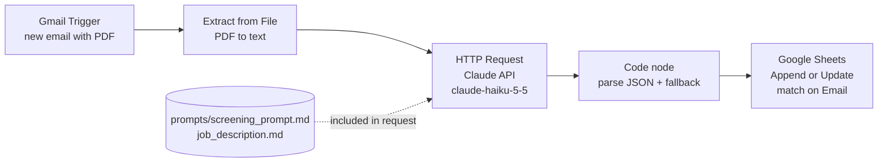

# AI Resume Screening Workflow

An n8n workflow that screens resumes automatically with Claude.

When someone emails a PDF resume, the workflow reads it, asks Claude to score it
against a job description, and saves the result to Google Sheets. Each candidate
gets one row, even if they apply twice.

## What it does

1. **Gmail Trigger** checks the inbox every minute for new emails with a PDF attached.
2. **Extract from File** turns the PDF into plain text.
3. **Claude - Score Resume** (HTTP Request) sends the resume text, the job description
   and a scoring rubric to the Claude API (`claude-haiku-5-5`).
4. Claude replies with JSON only: name, email, phone, score (0–100), a 3-line summary,
   top skills, missing skills and a recommendation (Shortlist / Maybe / Reject).
5. **Parse Claude JSON** (Code node) checks and cleans the reply. If something goes wrong
   it still writes a row, marked `NEEDS MANUAL REVIEW`.
6. **Google Sheets** uses *Append or Update Row*, matched on **Email**, so the same
   candidate is never added twice.

## Architecture



## Project structure

| Path | What it is |
|---|---|
| `n8n/resume_screener_workflow.json` | The n8n workflow, ready to import (no credentials inside) |
| `prompts/screening_prompt.md` | System prompt: scoring rubric and JSON output rules |
| `job_description.md` | The AI Intern job description the resumes are scored against |
| `scripts/generate_sample_resumes.py` | Creates 10 fake resume PDFs with reportlab |
| `sample_resumes/` | The 10 generated PDFs (3 strong, 4 medium, 3 weak fit) |
| `scripts/test_scoring.py` | Scores the sample PDFs from Python, without n8n |
| `sheet_template.csv` | Header row for the Google Sheet |
| `docs/screenshots/` | Screenshots of the workflow running |

All sample resumes are made up. Emails use the reserved `example.com` domain.

## Setup

### 1. Get a Claude API key

1. Sign in at [console.anthropic.com](https://console.anthropic.com) and create an API key.
2. For the Python test: `cp .env.example .env` and paste the key after `ANTHROPIC_API_KEY=`.
   `.env` is in `.gitignore`, so the key is never committed.

### 2. Test the prompt locally (optional, but do this first)

```bash
python3 -m venv .venv && source .venv/bin/activate
pip install -r requirements.txt
python scripts/generate_sample_resumes.py   # only needed if sample_resumes/ is empty
python scripts/test_scoring.py
```

This prints a table of name, score and recommendation for all 10 sample resumes.
The script sets a 60-second timeout, lets the SDK retry timeouts, rate limits and server
errors 3 times, and asks Claude again once if the reply is not valid JSON.

### 3. Create the Google Sheet

1. Create a new Google Sheet.
2. Import `sheet_template.csv` (File → Import → Upload), or type the headers in row 1:
   `Received At, Name, Email, Phone, Score, Recommendation, Summary, Top Skills, Missing Skills`
3. Copy the sheet ID from the URL: `docs.google.com/spreadsheets/d/<THIS_PART>/edit`.

### 4. Import the workflow into n8n

1. In n8n: **Workflows → Import from File** → choose `n8n/resume_screener_workflow.json`.
2. Create the credentials. The workflow refers to them by these names:

| Node | Credential type | Name in the workflow |
|---|---|---|
| Gmail Trigger | Gmail OAuth2 | `Gmail account` |
| Claude - Score Resume | Header Auth | `Anthropic API Key` (Name: `x-api-key`, Value: your key) |
| Google Sheets | Google Sheets OAuth2 | `Google Sheets account` |

3. Open each node and pick the credential if it is not already selected.
4. In the Google Sheets node, replace `PASTE_YOUR_GOOGLE_SHEET_ID_HERE` with your sheet ID
   and check that the sheet tab name is `Sheet1`.
5. Send yourself an email with one of the PDFs from `sample_resumes/` attached, then click
   **Test workflow**. When it works, turn the workflow **Active**.

The `anthropic-version: 2023-06-01` header is set directly in the HTTP node. The API key
lives only in the n8n credential, never in the workflow file.

## How the duplicate check works

The Google Sheets node uses the **Append or Update Row** operation with **Email** as the
column to match on.

- For each candidate, n8n looks for a row whose `Email` equals the candidate's email.
- If it finds one, it **updates** that row with the new score and summary.
- If not, it **appends** a new row.

The Code node lowercases and trims the email first, so `Aarav@Example.com` and
`aarav@example.com` count as the same person. If Claude cannot read an email from the
resume, the Code node uses the sender's email address instead, so the check still works.

## Scoring rubric

Defined in [`prompts/screening_prompt.md`](prompts/screening_prompt.md).

| Part | Points |
|---|---|
| Skills match with the job description | 40 |
| Relevant projects / experience | 30 |
| Tools: Claude / Anthropic API, n8n, Make, Zapier, APIs | 15 |
| Education | 10 |
| Communication / clarity of the resume | 5 |
| **Total** | **100** |

Recommendation: **Shortlist** at 70 or more, **Maybe** from 45 to 69, **Reject** below 45.
The Code node recalculates the recommendation from the score if Claude returns anything
other than these three words.

## Error handling

| Problem | What happens |
|---|---|
| Claude API is slow or down | HTTP node: 60 s timeout, 3 tries, 5 s apart |
| API still fails (bad key, rate limit) | Error goes to the Code node, which writes a `NEEDS MANUAL REVIEW` row |
| Claude wraps JSON in ```` ```json ```` or adds words around it | Code node strips them and keeps only the `{...}` part |
| JSON has raw line breaks inside a string | Code node tries again with line breaks turned into spaces |
| Score is out of range or not a number | Clamped to 0–100 |
| Recommendation is not Shortlist / Maybe / Reject | Recalculated from the score |

Known limits: the workflow reads only the first attachment (`attachment_0`), and scanned
PDFs with no text layer will not extract (they would need OCR).

## Test Results

> **TODO:** run `python scripts/test_scoring.py` and the n8n workflow, then fill this in.

| Name | Expected fit | Score | Recommendation |
|---|---|---|---|
| TODO | | | |

- Did the 3 strong / 4 medium / 3 weak resumes land where expected? TODO
- Did the duplicate check work when the same resume was sent twice? TODO
- Screenshots: add them to `docs/screenshots/` and link them here. TODO

## n8n vs Make vs Zapier

> **TODO:** build the same flow (Gmail → PDF text → Claude → Google Sheets) in Make and
> Zapier, then write your own observations below. Nothing here is filled in yet.

### Setup time
- n8n: TODO
- Make: TODO
- Zapier: TODO

### Calling the Claude API (HTTP request, headers, JSON body)
- n8n: TODO
- Make: TODO
- Zapier: TODO

### PDF text extraction
- n8n: TODO
- Make: TODO
- Zapier: TODO

### Custom code and JSON parsing
- n8n: TODO
- Make: TODO
- Zapier: TODO

### Duplicate check (update row if email exists)
- n8n: TODO
- Make: TODO
- Zapier: TODO

### Error handling and retries
- n8n: TODO
- Make: TODO
- Zapier: TODO

### Pricing / free tier limits for this use case
- n8n: TODO
- Make: TODO
- Zapier: TODO

### Which one I would pick and why
TODO
