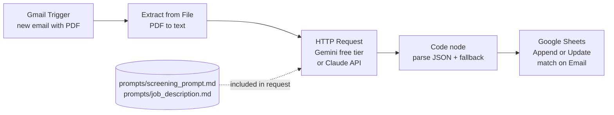
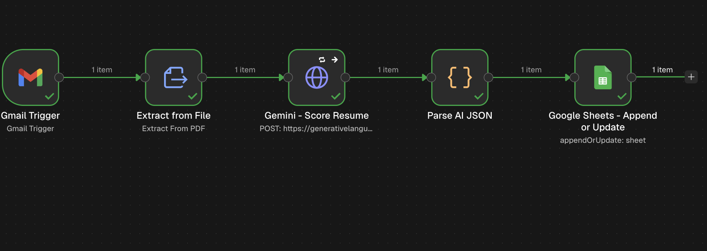
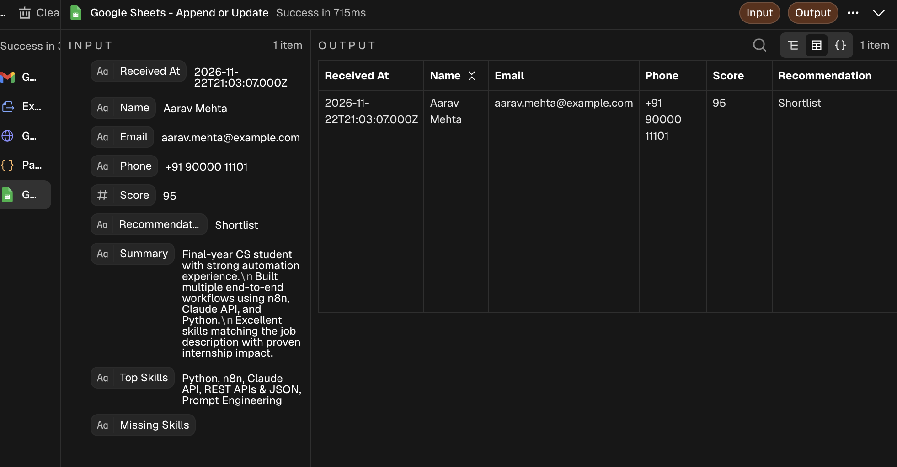
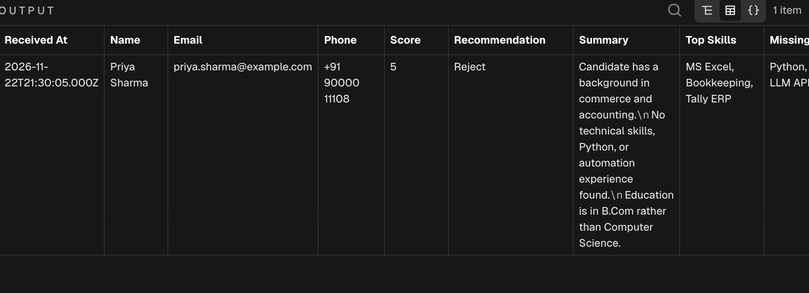
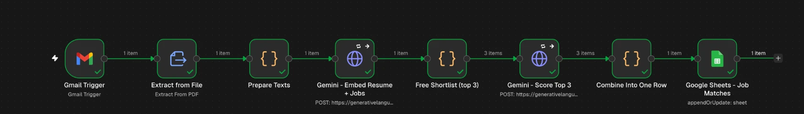

# AI Resume Screener

[](https://github.com/arnav2293-afk/ai-resume-screener/actions/workflows/ci.yml)
[](LICENSE)
[](https://arnav2293-afk.github.io/ai-resume-screener/)

Two AI hiring prototypes built with n8n, Python and LLM APIs. All resumes and jobs in this
repository are made up.

| Prototype | What it does | Built with |
|---|---|---|
| **1. AI Resume Screener** | Reads each emailed PDF resume, scores it against a job description and logs one row per candidate in Google Sheets | n8n, Gemini (free) or Claude |
| **2. [Smart Job Matcher](matcher/)** | Checks each resume against **every** open job. A free embeddings step keeps the top 3, so the AI scores 3 jobs instead of 15 | Python + Streamlit, and an n8n version |

**Live demo:** [arnav2293-afk.github.io/ai-resume-screener](https://arnav2293-afk.github.io/ai-resume-screener/),
a one-page tour of both prototypes with real test results.


*Real output: three sample resumes emailed in, scored and logged automatically.*

## Contents

- [Prototype 1: AI Resume Screener](#prototype-1-ai-resume-screener)
- [Prototype 2: Smart Job Matcher](#prototype-2-smart-job-matcher)
- [Quick start](#quick-start)
- [Development](#development)
- [Project structure](#project-structure)
- [Roadmap](#roadmap)

## Prototype 1: AI Resume Screener

When someone emails a PDF resume, the workflow reads it, asks an LLM to score it against a job
description, and saves the result to Google Sheets. Each candidate gets one row, even if they
apply twice.



### How it works

1. **Gmail Trigger** checks the inbox every minute for new emails with a PDF attached. Emails
   with "job match" in the subject are left for the Smart Job Matcher.
2. **Extract from File** turns the PDF into plain text.
3. **Gemini - Score Resume** (HTTP Request) sends the resume text, the
   [job description](prompts/job_description.md) and the [scoring rubric](prompts/screening_prompt.md)
   to the model.
4. The model replies with JSON only: name, email, phone, score (0 to 100), a 3-line summary,
   top skills, missing skills and a recommendation (Shortlist / Maybe / Reject).
5. **Parse AI JSON** (Code node) checks and cleans the reply. It understands both Gemini and
   Claude reply formats. If anything goes wrong, it still writes a row marked
   `NEEDS MANUAL REVIEW`, so no candidate is lost.
6. **Google Sheets** uses *Append or Update Row*, matched on **Email**, so the same candidate is
   never added twice.

The workflow in n8n after a successful run (each node shows a green tick and "1 item"):



### Choice of model

The workflow was designed for the **Claude API** (`claude-haiku-5-5`), and a Claude version is
included. The default version runs on **Gemini's free tier** (`gemini-3.5-flash-lite`), so the
project costs nothing to run. Both use the same prompt, rubric and parsing code:

| | Gemini (default, free) | Claude (paid) |
|---|---|---|
| n8n workflow | [`resume_screener_workflow.json`](n8n/resume_screener_workflow.json) | [`resume_screener_workflow_claude.json`](n8n/resume_screener_workflow_claude.json) |
| Python test | `python scripts/test_scoring.py` | `python scripts/test_scoring.py --provider claude` |
| Model | `gemini-3.5-flash-lite` | `claude-haiku-5-5` |
| Auth header | `x-goog-api-key` | `x-api-key` + `anthropic-version: 2023-06-01` |
| JSON output | Prompt rules + Gemini JSON mode (`responseMimeType: application/json`) | Prompt rules |
| Cost | Free, with daily request limits | $0.10 per million input tokens, $0.50 per million output tokens |

Switching providers only changes the HTTP Request node. The Gmail, PDF, Code and Google Sheets
nodes stay the same.

**Privacy:** on Gemini's free tier, Google may use what you send to improve its products. That is
fine for the made-up sample resumes here. Real candidates' resumes should go to a paid tier of
either provider.

### Scoring rubric

Defined in [`prompts/screening_prompt.md`](prompts/screening_prompt.md).

| Part | Points |
|---|---|
| Skills match with the job description | 40 |
| Relevant projects / experience | 30 |
| Tools: Claude / Anthropic API, n8n, Make, Zapier, APIs | 15 |
| Education | 10 |
| Communication / clarity of the resume | 5 |
| **Total** | **100** |

Recommendation: **Shortlist** at 70 or more, **Maybe** from 45 to 69, **Reject** below 45. The
Code node recalculates the recommendation from the score if the model returns anything else.

### Duplicate check

The Google Sheets node uses **Append or Update Row** with **Email** as the column to match on.
If a row with the candidate's email exists, n8n updates it with the new score and summary;
otherwise it appends a new row.

The Code node lowercases and trims the email first, so `Aarav@Example.com` and
`aarav@example.com` count as the same person. If the model finds no email in the resume, the
sender's address is used instead, so the check still works.

### Error handling

| Problem | What happens |
|---|---|
| AI API is slow or down | HTTP node: 60 s timeout, 3 tries, 5 s apart |
| API still fails (bad key, free-tier quota used up) | The error goes to the Code node, which writes a `NEEDS MANUAL REVIEW` row with a short reason such as `503 The model is overloaded` |
| Model stops early (token limit, safety block, refusal) | `NEEDS MANUAL REVIEW` row with the reason |
| Model wraps the JSON in a code fence or adds words around it | The Code node keeps only the `{...}` part |
| JSON has raw line breaks inside a string | The Code node tries again with line breaks turned into spaces |
| Score is out of range or not a number | Clamped to 0 to 100 |
| Phone like `+91 ...` read as a formula by Sheets | The Sheets node stores values as sent (*Cell Format: Let n8n format*) |
| Recommendation is not Shortlist / Maybe / Reject | Recalculated from the score |

Known limits:
- The workflow reads only the first attachment (`attachment_0`).
- Scanned PDFs with no text layer won't extract (they would need OCR).
- Gemini's free tier has a daily request limit, so it suits a demo, not high volume.

### Test results

**Local Python test (23 Nov 2026).** Command: `python scripts/test_scoring.py`, Gemini free tier.

| Name | Expected fit | Score | Recommendation |
|---|---|---|---|
| Aarav Mehta | Strong | 95 | Shortlist |
| Diya Krishnan | Strong | 90 | Shortlist |
| Kabir Singh | Strong | 88 | Shortlist |
| Ananya Iyer | Medium | 42 | Reject |
| Rohan Desai | Medium | 42 | Reject |
| Meera Nair | Medium | 42 | Reject |
| Arjun Reddy | Medium | 42 | Reject |
| Vikram Patel | Weak | 10 | Reject |
| Priya Sharma | Weak | 5 | Reject |
| Sneha Gupta | Weak | 5 | Reject |

- All 10 resumes were scored with valid JSON: no errors and no fallback rows.
- Strong and weak candidates were classified as expected, and the ranking makes sense.
- A second run gave the same scores for 9 of 10 resumes. Only Sneha Gupta changed, from 5 to 0.
- **Weakness:** all 4 medium candidates got exactly 42, just below the Maybe cut-off of 45. The
  model gives every in-between resume the same score instead of telling them apart. See the
  [roadmap](#roadmap) for the planned fix.

**n8n test (23 Nov 2026).** n8n Cloud, Gemini workflow, real emails with sample PDFs attached.

| Candidate | Score | Recommendation | Result |
|---|---|---|---|
| Aarav Mehta (strong) | 95 | Shortlist | Row added with summary, top skills and missing skills |
| Rohan Desai (medium) | 42 | Reject | Row added (same score as in the Python test) |
| Priya Sharma (weak) | 5 | Reject | Row added (same score as in the Python test) |

- End to end, Gmail → PDF text → Gemini → Code node → Google Sheets, with all 5 nodes green.
- All three scores matched the local Python test exactly.
- **Duplicate check:** running the workflow again on Aarav's email updated his existing row.

Problems found and fixed during testing:
- **Phone showed `#ERROR!` in Sheets.** Numbers like `+91 90000 11101` start with `+`, so Sheets
  treated them as formulas. Fixed by setting *Cell Format* to *Let n8n format* (RAW).
- **"Requested entity was not found" from Sheets.** The sheet ID was still the placeholder. Fixed
  by picking the sheet from the list in the node.
- **A resume seemed to go missing.** In test mode, each *Execute workflow* click reads only the
  newest matching email, and the workflow reads only the first attachment. Sending one PDF per
  email fixed it. When the workflow is published, it checks Gmail every minute by itself.

The Code node's output for a strong candidate: clean fields ready for the sheet.


The Google Sheets node: input from the Code node on the left, the row it wrote on the right
("Success in 715ms").



A weak candidate is handled the same way: low score, Reject, and a summary saying why.



## Prototype 2: Smart Job Matcher

The screener checks a resume against one job only. The [Smart Job Matcher](matcher/) checks one
resume against **every** open job. A free embeddings step shortlists the 3 closest jobs, and the
AI scores only those 3.

- In a test with 10 resumes and 15 jobs, **7 of 10 candidates had a better-fitting opening**
  (75 or more) than the one they applied for.
- **80% fewer AI calls:** 30 instead of 150. About **Rs 0.02 per resume**, measured.
- **Two versions:** a Python command line and Streamlit app with a local embedding model, and an
  [n8n workflow](n8n/smart_job_matcher_workflow.json) that uses Gemini's free embeddings API.



Setup, full results and limitations: [`matcher/README.md`](matcher/README.md).

## Quick start

### 1. Get an API key

Create a free Gemini key at [aistudio.google.com/apikey](https://aistudio.google.com/apikey) (no
credit card needed). For the Claude version, create a key at
[console.anthropic.com](https://console.anthropic.com) instead.

```bash
cp .env.example .env   # then paste the key after GEMINI_API_KEY= (or ANTHROPIC_API_KEY=)
```

`.env` is in `.gitignore`, so the key is never committed.

### 2. Test the prompt locally (optional, do this first)

```bash
python3 -m venv .venv && source .venv/bin/activate
pip install -r requirements.txt
python scripts/test_scoring.py   # add --provider claude for the Claude version
```

This prints the name, score and recommendation for all 10 sample resumes. Each request has a
60-second timeout and up to 3 retries, an invalid JSON reply is asked again once, and with Gemini
the script waits 5 seconds between resumes to stay under the free tier's per-minute limit.
`python scripts/generate_sample_resumes.py` recreates the sample PDFs if needed.

### 3. Create the Google Sheet

1. Create a new Google Sheet.
2. Import [`sheet_templates/resume_screener.csv`](sheet_templates/resume_screener.csv)
   (File → Import → Upload), or type the headers in row 1:
   `Received At, Name, Email, Phone, Score, Recommendation, Summary, Top Skills, Missing Skills`.
3. Copy the sheet ID from the URL: `docs.google.com/spreadsheets/d/<THIS_PART>/edit`.

### 4. Import the workflow into n8n

1. In n8n: **Import from File** → choose `n8n/resume_screener_workflow.json`.
2. Create the credentials. The workflow refers to them by these names:

   | Node | Credential type | Name in the workflow |
   |---|---|---|
   | Gmail Trigger | Gmail OAuth2 | `Gmail account` |
   | Gemini - Score Resume | Header Auth | `Gemini API Key` (Name: `x-goog-api-key`, Value: your key) |
   | Google Sheets | Google Sheets OAuth2 | `Google Sheets account` |

   For the Claude version, the HTTP node uses a Header Auth credential named `Anthropic API Key`
   (Name: `x-api-key`, Value: your Claude key).
3. Open each node and pick the credential if it is not already selected.
4. In the Google Sheets node, choose your sheet (or replace `PASTE_YOUR_GOOGLE_SHEET_ID_HERE` with
   its ID) and check that the sheet tab is `Sheet1`.
5. Email yourself one of the PDFs from `sample_resumes/`, then click **Execute workflow**. When it
   works, click **Publish** so it runs every minute.

The API key lives only in the n8n credential, never in the workflow file.

## Development

```bash
pip install -r requirements-dev.txt
ruff check .   # lint
pytest         # tests: no API keys or network needed
```

The tests run the real JavaScript from every n8n Code node with Node.js (or macOS's built-in
JavaScript engine) on good replies, broken JSON, API errors and failed calls. They also check that
each workflow is one connected chain with retries, has no credential IDs or API keys inside, and
writes exactly the columns in `sheet_templates/`. [GitHub Actions](.github/workflows/ci.yml) runs
the lint and tests on every push.

The live demo page is built from [`showcase/template.html`](showcase/template.html) and the real
matcher results: `python showcase/build_showcase.py` (needs `matcher/requirements.txt`).

## Project structure

| Path | What it is |
|---|---|
| [`n8n/`](n8n/) | The three workflows, ready to import, with no credentials inside |
| [`prompts/`](prompts/) | The screening and matching prompts, and the job description the screener uses |
| [`scripts/`](scripts/) | Generate the sample resumes; score them from Python without n8n |
| [`matcher/`](matcher/) | Smart Job Matcher: command line, Streamlit app, the 15 open jobs and the test results |
| [`sample_resumes/`](sample_resumes/) | 10 made-up resume PDFs (3 strong, 4 medium, 3 weak fit) |
| [`sheet_templates/`](sheet_templates/) | Header rows for the Google Sheet tabs |
| [`showcase/`](showcase/) | The live demo page and the script that builds it |
| [`docs/screenshots/`](docs/screenshots/) | Screenshots from real runs |
| [`tests/`](tests/) | Automated tests, run in CI |
| `index.html` | Sends visitors from the GitHub Pages address to `showcase/` |

All sample resumes are made up. Emails use the reserved `example.com` domain.

## Roadmap

- **Fix the medium band:** ask the model for a score per rubric part and add them up in the Code
  node, so the total is calculated, not guessed. Label a few resumes by hand and tune the cut-offs.
- **Compare with Make and Zapier:** rebuild the same Gmail → Google Sheets steps and compare setup
  time, AI API calls, PDF extraction, the duplicate check, error handling and free-tier limits.
- **Smart Job Matcher:** store job embeddings once instead of per resume, and add keyword search
  for exact terms (see [`matcher/README.md`](matcher/README.md#limitations)).

## License

[MIT](LICENSE)
