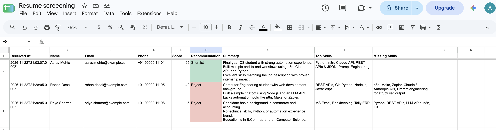
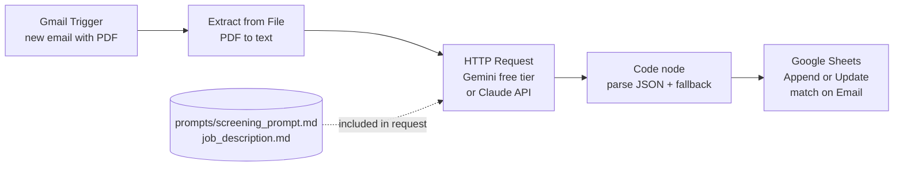
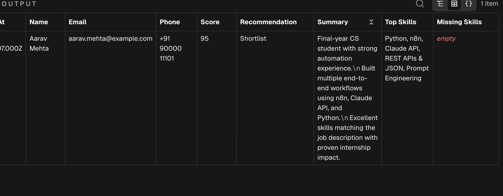

# AI Resume Screening Workflow

An n8n workflow that screens resumes automatically with an LLM.

When someone emails a PDF resume, the workflow reads it, asks an AI model to score it
against a job description, and saves the result to Google Sheets. Each candidate
gets one row, even if they apply twice.


*Real output from a test run: three sample resumes emailed in, scored and logged automatically.*

## Which AI model, and why

The workflow was designed for the **Claude API** (`claude-haiku-5-5`). The Claude API
needs prepaid credits, and I chose not to spend money on a portfolio project, so the
default version runs on **Google Gemini's free tier** (`gemini-3.5-flash-lite`).

Both versions are in the repo and use the same prompt, rubric and parsing code:

| | Gemini (default, free) | Claude (paid) |
|---|---|---|
| n8n workflow | `n8n/resume_screener_workflow.json` | `n8n/resume_screener_workflow_claude.json` |
| Python test | `python scripts/test_scoring.py` | `python scripts/test_scoring.py --provider claude` |
| Model | `gemini-3.5-flash-lite` | `claude-haiku-5-5` |
| Auth header | `x-goog-api-key` | `x-api-key` + `anthropic-version: 2023-06-01` |
| JSON output | Prompt rules + Gemini JSON mode (`responseMimeType: application/json`) | Prompt rules |
| Cost | Free, with daily request limits | About $0.10 per million input tokens |

Switching providers only changes the HTTP Request node. The Gmail, PDF, Code and
Google Sheets nodes stay the same.

**Privacy note:** on Gemini's free tier, Google may use what you send to improve its
products (the paid tier does not). That's fine for the fake sample resumes here. For
real candidates' resumes, use a paid tier of either provider.

## What it does

1. **Gmail Trigger** checks the inbox every minute for new emails with a PDF attached.
2. **Extract from File** turns the PDF into plain text.
3. **Gemini - Score Resume** (HTTP Request) sends the resume text, the job description
   and a scoring rubric to the AI model.
4. The model replies with JSON only: name, email, phone, score (0–100), a 3-line summary,
   top skills, missing skills and a recommendation (Shortlist / Maybe / Reject).
5. **Parse AI JSON** (Code node) checks and cleans the reply. It understands both Gemini
   and Claude reply formats. If something goes wrong it still writes a row, marked
   `NEEDS MANUAL REVIEW`.
6. **Google Sheets** uses *Append or Update Row*, matched on **Email**, so the same
   candidate is never added twice.

## Architecture



The same workflow in n8n, after a successful run (each node shows a green tick and "1 item"):


## New: Smart Job Matcher prototype

[`matcher/`](matcher/) checks one resume against **every** open job. A free embeddings step
shortlists the top 3 jobs, and the AI scores only those 3. In a test with 10 resumes and 15 jobs,
7 of 10 candidates had a better-fitting opening than the one they applied for, using 80% fewer
AI calls (about Rs 0.02 per resume, measured). See [`matcher/README.md`](matcher/README.md).

## Project structure

| Path | What it is |
|---|---|
| `n8n/resume_screener_workflow.json` | The n8n workflow using Gemini (free), ready to import, no credentials inside |
| `n8n/resume_screener_workflow_claude.json` | Same workflow using the Claude API |
| `prompts/screening_prompt.md` | System prompt: scoring rubric and JSON output rules |
| `job_description.md` | The AI Intern job description the resumes are scored against |
| `scripts/generate_sample_resumes.py` | Creates 10 fake resume PDFs with reportlab |
| `sample_resumes/` | The 10 generated PDFs (3 strong, 4 medium, 3 weak fit) |
| `scripts/test_scoring.py` | Scores the sample PDFs from Python, without n8n |
| `matcher/` | Smart Job Matcher prototype: one resume vs all open jobs |
| `prompts/matching_prompt.md` | Rubric for scoring a resume against any job |
| `sheet_template.csv` | Header row for the Google Sheet |
| `docs/screenshots/` | Screenshots of the workflow running |

All sample resumes are made up. Emails use the reserved `example.com` domain.

## Setup

### 1. Get a free Gemini API key

1. Go to [aistudio.google.com/apikey](https://aistudio.google.com/apikey), sign in with a
   Google account and click **Create API key**. No credit card is needed.
2. For the Python test: `cp .env.example .env` and paste the key after `GEMINI_API_KEY=`.
   `.env` is in `.gitignore`, so the key is never committed.

(For the Claude version, create a key at [console.anthropic.com](https://console.anthropic.com)
and paste it after `ANTHROPIC_API_KEY=` instead.)

### 2. Test the prompt locally (optional, but do this first)

```bash
python3 -m venv .venv && source .venv/bin/activate
pip install -r requirements.txt
python scripts/generate_sample_resumes.py   # only needed if sample_resumes/ is empty
python scripts/test_scoring.py
```

This prints a table of name, score and recommendation for all 10 sample resumes.

- Each request has a 60-second timeout.
- The SDK retries timeouts, rate limits and server errors up to 3 times.
- If the reply isn't valid JSON, the script asks again once.
- With Gemini it waits 5 seconds between resumes to stay under the free tier's
  requests-per-minute limit. You can see your exact limits in Google AI Studio.

### 3. Create the Google Sheet

1. Create a new Google Sheet.
2. Import `sheet_template.csv` (File → Import → Upload), or type the headers in row 1:
   `Received At, Name, Email, Phone, Score, Recommendation, Summary, Top Skills, Missing Skills`
3. Copy the sheet ID from the URL: `docs.google.com/spreadsheets/d/<THIS_PART>/edit`.

### 4. Import the workflow into n8n

1. In n8n: **Workflows → Import from File** → choose `n8n/resume_screener_workflow.json`.
2. Create the credentials. The workflow refers to them by these names:

| Node | Credential type | Name in the workflow |
|---|---|---|
| Gmail Trigger | Gmail OAuth2 | `Gmail account` |
| Gemini - Score Resume | Header Auth | `Gemini API Key` (Name: `x-goog-api-key`, Value: your key) |
| Google Sheets | Google Sheets OAuth2 | `Google Sheets account` |

   For the Claude version, the HTTP node uses a Header Auth credential named
   `Anthropic API Key` (Name: `x-api-key`, Value: your Claude key).

3. Open each node and pick the credential if it is not already selected.
4. In the Google Sheets node, replace `PASTE_YOUR_GOOGLE_SHEET_ID_HERE` with your sheet ID
   and check that the sheet tab name is `Sheet1`.
5. Send yourself an email with one of the PDFs from `sample_resumes/` attached, then click
   **Test workflow**. When it works, turn the workflow **Active**.

The API key lives only in the n8n credential, never in the workflow file.

## How the duplicate check works

The Google Sheets node uses the **Append or Update Row** operation with **Email** as the
column to match on.

- For each candidate, n8n looks for a row whose `Email` equals the candidate's email.
- If it finds one, it **updates** that row with the new score and summary.
- If not, it **appends** a new row.

The Code node lowercases and trims the email first, so `Aarav@Example.com` and
`aarav@example.com` count as the same person. If the model can't find an email in the
resume, the Code node uses the sender's email address instead, so the check still works.

## Scoring rubric

Defined in [`prompts/screening_prompt.md`](prompts/screening_prompt.md).

| Part | Points |
|---|---|
| Skills match with the job description | 40 |
| Relevant projects / experience | 30 |
| Tools: Claude / Anthropic API, n8n, Make, Zapier, APIs | 15 |
| Education | 10 |
| Communication / clarity of the resume | 5 |
| **Total** | **100** |

Recommendation: **Shortlist** at 70 or more, **Maybe** from 45 to 69, **Reject** below 45.
The Code node recalculates the recommendation from the score if the model returns anything
other than these three words.

## Error handling

| Problem | What happens |
|---|---|
| AI API is slow or down | HTTP node: 60 s timeout, 3 tries, 5 s apart |
| API still fails (bad key, free-tier quota used up) | Error goes to the Code node, which writes a `NEEDS MANUAL REVIEW` row |
| Model stops early (token limit, safety block, refusal) | `NEEDS MANUAL REVIEW` row with the reason |
| Model wraps JSON in ```` ```json ```` or adds words around it | Code node strips them and keeps only the `{...}` part |
| JSON has raw line breaks inside a string | Code node tries again with line breaks turned into spaces |
| Score is out of range or not a number | Clamped to 0–100 |
| Phone like `+91 ...` read as a formula by Sheets | Sheets node stores values raw (*Cell Format: Let n8n format*) |
| Recommendation is not Shortlist / Maybe / Reject | Recalculated from the score |

Known limits:
- The workflow reads only the first attachment (`attachment_0`).
- Scanned PDFs with no text layer won't extract (they would need OCR).
- Gemini's free tier has a daily request limit, so it suits a demo, not high volume.

## Test Results

### Local Python test (one run, 2026-11-23)

Command: `python scripts/test_scoring.py`. Provider: Gemini free tier, model `gemini-3.5-flash-lite`.

| Name | Expected fit | Score | Recommendation |
|---|---|---|---|
| Aarav Mehta | Strong | 95 | Shortlist |
| Diya Krishnan | Strong | 90 | Shortlist |
| Kabir Singh | Strong | 88 | Shortlist |
| Ananya Iyer | Medium | 42 | Reject |
| Rohan Desai | Medium | 42 | Reject |
| Meera Nair | Medium | 42 | Reject |
| Arjun Reddy | Medium | 42 | Reject |
| Vikram Patel | Weak | 10 | Reject |
| Priya Sharma | Weak | 5 | Reject |
| Sneha Gupta | Weak | 5 | Reject |

**What I observed**
- All 10 resumes were scored with valid JSON. No errors and no fallback rows.
- Strong and weak candidates were classified as expected, and the ranking order makes sense.
- **Weakness:** all 4 medium candidates got exactly 42, just below the Maybe cutoff of 45,
  so none were marked Maybe. The model seems to give every in-between resume the same
  score instead of telling them apart.
- This is a single run. Scores may vary between runs.

**Ideas to fix the medium band (not done yet)**
- Ask the model to return a score for each of the 5 rubric parts, and add them up in the
  Code node, so the total is calculated, not guessed.
- Label a few resumes by hand and adjust the cutoffs to match.

### n8n workflow test

Run on n8n Cloud on 2026-11-23, using the Gemini workflow and real emails sent to my Gmail
with sample PDFs attached.

| Candidate | Score | Recommendation | Result |
|---|---|---|---|
| Aarav Mehta (strong) | 95 | Shortlist | Row added with summary, top skills and missing skills |
| Rohan Desai (medium) | 42 | Reject | Row added (same score as in the Python test) |
| Priya Sharma (weak) | 5 | Reject | Row added (same score as in the Python test) |

All three n8n scores matched the local Python test exactly.

**What worked**
- End to end, Gmail → PDF text → Gemini → Code node → Google Sheets, with all 5 nodes green.
- **Duplicate check:** running the workflow again on Aarav's email updated his existing row.
  The sheet still had one row for him.

**Problems I found and fixed**
- **Phone showed `#ERROR!` in Sheets.** Numbers like `+91 90000 11101` start with `+`, so
  Google Sheets treated them as formulas. Fixed by setting the Sheets node's
  *Cell Format* to *Let n8n format* (RAW), which stores values exactly as sent.
- **"Requested entity was not found" from Sheets.** The sheet ID was still the placeholder.
  Fixed by picking the sheet from the list in the node.

- **A resume seemed to go missing.** In test mode, each *Execute* click reads only the
  newest matching email, and the workflow only reads the first attachment of an email.
  Sending one PDF per email and running once per email fixed it. When the workflow is
  published (active), it checks Gmail every minute and handles each new email by itself.

**Screenshots**

What the Code node outputs for a strong candidate: clean fields ready for the sheet.



The Google Sheets node: the input from the Code node on the left, and the row it wrote on
the right ("Success in 715ms").


A weak candidate is handled the same way: low score, Reject, and a summary saying why.


## n8n vs Make vs Zapier

> **TODO:** build the same flow (Gmail → PDF text → AI model → Google Sheets) in Make and
> Zapier, then write your own observations below. Nothing here is filled in yet.

### Setup time
- n8n: TODO
- Make: TODO
- Zapier: TODO

### Calling the AI API (HTTP request, headers, JSON body)
- n8n: TODO
- Make: TODO
- Zapier: TODO

### PDF text extraction
- n8n: TODO
- Make: TODO
- Zapier: TODO

### Custom code and JSON parsing
- n8n: TODO
- Make: TODO
- Zapier: TODO

### Duplicate check (update row if email exists)
- n8n: TODO
- Make: TODO
- Zapier: TODO

### Error handling and retries
- n8n: TODO
- Make: TODO
- Zapier: TODO

### Pricing / free tier limits for this use case
- n8n: TODO
- Make: TODO
- Zapier: TODO

### Which one I would pick and why
TODO
