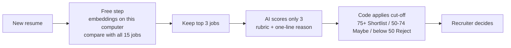

# Smart Job Matcher (prototype)

A small working prototype of two ideas: **check one resume against every open job**, and
**search past candidates before sourcing fresh**. It uses a free step first, so the paid AI only
scores a short list.

All jobs and resumes are made up.

## How it works



1. **Free shortlist.** `all-MiniLM-L6-v2` (sentence-transformers) turns each resume and job into
   embeddings: numbers that capture meaning. Cosine similarity finds the 3 closest jobs. It runs on
   the CPU, with no API call and no cost.
2. **AI scores 3, not 15.** The AI scores the resume against each of the 3 jobs with the rubric in
   [`prompts/matching_prompt.md`](../prompts/matching_prompt.md) and returns JSON: score and reason.
3. **Code applies the cut-off,** so the rule is always the same. 75 matches the threshold in the BRD.
4. **Failures are never lost.** If the AI call fails, the row is marked `REVIEW` for a person.

**Idea 2 (Talent Pool Rediscovery)** is the same engine in reverse: for a new job, rank the
candidates already in the pool. It's free, with no AI call. If nobody is close enough (similarity
below 0.45), it says "start fresh sourcing" instead of suggesting weak candidates.

## Run it

```bash
pip install -r matcher/requirements.txt
python matcher/smart_job_matcher.py               # Idea 1 with AI scoring (needs GEMINI_API_KEY in .env)
python matcher/smart_job_matcher.py --no-ai       # Idea 1, free shortlist only
python matcher/smart_job_matcher.py --pool JOB-09 # Idea 2 for one job
```

## Results (one run, 24 Nov 2026)

10 sample resumes, all written for the AI Intern job (JOB-01), against 15 open jobs.
AI model: `gemini-3.5-flash-lite` (free tier). Full output: [`results.csv`](results.csv).

| Candidate | Applied for: AI Intern | Best match found | Score |
|---|---|---|---|
| Aarav Mehta | 95 Shortlist | AI Intern | 95 |
| Diya Krishnan | 92 Shortlist | AI Intern | 92 |
| Kabir Singh | 92 Shortlist | AI Intern | 92 |
| Ananya Iyer | 45 Reject | **ML Engineer Intern** | 90 |
| Rohan Desai | 60 Maybe | **Frontend Web Developer Intern** | 95 |
| Meera Nair | not in her top 3 | **Business Analyst - Operations** | 85 |
| Arjun Reddy | 45 Reject | **Chatbot Developer** (Backend Python also 85) | 85 |
| Priya Sharma | not in her top 3 | **Accounts and Taxation Executive** | 85 |
| Vikram Patel | 10 Reject | **Mechanical Design Engineer** | 85 |
| Sneha Gupta | not in her top 3 | **Graphic Designer** | 85 |

**7 of 10 candidates had a better-fitting opening (75 or more) than the job they applied for.**
Checked against one job only, most of them would have been rejected.

**Cost (measured in this run):**
- AI calls: 30 instead of 150 (80% fewer).
- Tokens: 17,951 in, 1,554 out.
- At Claude Haiku 5.5 list prices ($0.10 / $0.50 per million tokens), that's $0.0026 in total,
  about **Rs 0.02 per resume** (at an assumed Rs 88 per USD).
- These are Gemini's token counts. Claude counts tokens slightly differently and thinks before
  answering, which adds output tokens, so treat Rs 0.15 per resume as a safe upper estimate.

**Talent pool (Idea 2):**
- JOB-09 Business Analyst: Meera Nair (0.54).
- JOB-03 ML Intern: Ananya Iyer (0.66).
- JOB-10 Wealth Relationship Manager: no strong match (best 0.32), so start fresh sourcing.

## Limits (honest)

- Small test: 10 made-up resumes and 15 made-up jobs. The 0.45 threshold was picked from this
  data. Real use needs testing on past, closed roles: compare the matcher's picks with recruiters'
  picks.
- Embeddings only for the shortlist. Adding BM25 keyword search merged with RRF (as in my Ask Your
  PDF project) would help with exact terms like "NISM" or "GST".
- On the first run, 3 of 30 AI calls failed with server errors (free tier busy). They were marked
  for review. I added longer retries (10 s, then 20 s) and all 30 succeeded on the second run.
- Free tier data may be used by Google to improve its products, so it's for made-up data only.
  Real candidate data should go to a paid tier or a local model.
