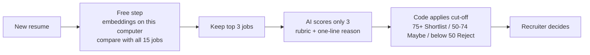
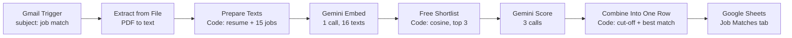
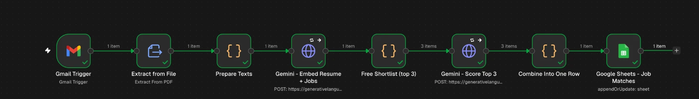
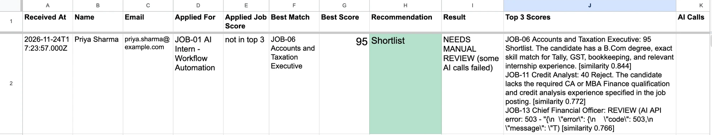
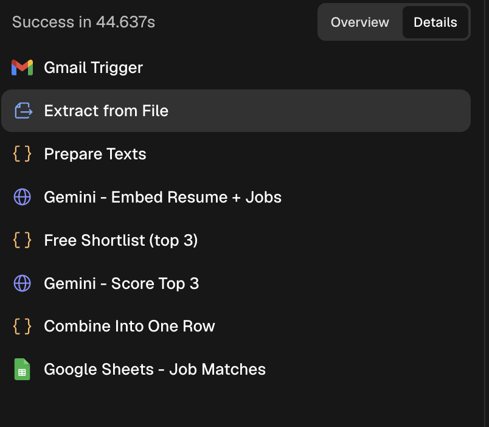

# Smart Job Matcher (prototype)

A small working prototype of two ideas: **check one resume against every open job**, and
**search past candidates before sourcing fresh**. It uses a free step first, so the paid AI only
scores a short list.

All jobs and resumes are made up.

## How it works



1. **Free shortlist.** `all-MiniLM-L6-v2` (sentence-transformers) turns each resume and job into
   embeddings: numbers that capture meaning. Cosine similarity finds the 3 closest jobs. It runs on
   the CPU, with no API call and no cost.
2. **AI scores 3, not 15.** The AI scores the resume against each of the 3 jobs with the rubric in
   [`prompts/matching_prompt.md`](../prompts/matching_prompt.md) and returns JSON: score and reason.
3. **Code applies the cut-off,** so the rule is always the same. 75 matches the threshold in the BRD.
4. **Failures are never lost.** If the AI call fails, the row is marked `REVIEW` for a person.

**Idea 2 (Talent Pool Rediscovery)** is the same engine in reverse: for a new job, rank the
candidates already in the pool. It's free, with no AI call. If nobody is close enough (similarity
below 0.45), it says "start fresh sourcing" instead of suggesting weak candidates.

## Live demo app

```bash
.venv/bin/streamlit run matcher/app.py
```

Then open http://localhost:8501. Pick a sample resume (or upload a made-up one), choose the job
they applied for, and click **Run matcher**. The app shows the 4 steps live: the extracted text,
the free shortlist across all 15 jobs, the AI scores for the top 3 with reasons, and the result
with the measured cost for that resume. The **Talent pool** tab runs Idea 2.

If the AI is busy, sample resumes fall back to their saved scores from the test run. The app
labels those clearly.

## n8n version

The same idea as an n8n workflow: [`n8n/smart_job_matcher_workflow.json`](../n8n/smart_job_matcher_workflow.json).



| Node | What it does |
|---|---|
| **Gmail Trigger** | New emails with a PDF and "job match" in the subject. Put the job code in the subject (e.g. `Job Match JOB-04`), or it uses JOB-01. |
| **Extract from File** | PDF to plain text. |
| **Prepare Texts** (Code) | Holds the 15 open jobs. Finds the name and email in the resume. Builds one embeddings request: the resume plus all 15 jobs. |
| **Gemini - Embed Resume + Jobs** (HTTP) | `gemini-embedding-001`, free. Turns all 16 texts into numbers in one call. |
| **Free Shortlist (top 3)** (Code) | Cosine similarity between the resume and each job, keeps the top 3. No AI call. If the embeddings call failed, it scores only the job they applied for, so nobody is lost. |
| **Gemini - Score Top 3** (HTTP) | `gemini-3.5-flash-lite`, the rubric in `prompts/matching_prompt.md`. One call per shortlisted job. |
| **Combine Into One Row** (Code) | Checks each JSON reply, applies the 75 / 50 cut-off in code, picks the best match, and says if a better opening was found. Failed calls become `REVIEW`. |
| **Google Sheets - Job Matches** | Append or Update on **Email**, so one row per candidate. |

The local Python version uses a model on this computer for the free step. n8n Cloud can't run that,
so this version uses Gemini's free embeddings API instead. It gave the same #1 job as the local
model for all 10 sample resumes.

**Setup**
1. In your Google Sheet, add a tab named `Job Matches`. Paste the header row from
   [`sheet_templates/job_matches.csv`](../sheet_templates/job_matches.csv) into row 1.
2. In n8n: **Import from File**, choose `n8n/smart_job_matcher_workflow.json`.
3. Pick the same credentials as the screener: Gmail, the Gemini API Key (Header Auth,
   `x-goog-api-key`) on both HTTP nodes, and Google Sheets. Paste your Sheet ID in the Sheets node.
4. Email a sample resume to yourself with the subject `Job Match JOB-01`, then click **Execute workflow**.

The screener workflow also picks up emails with a PDF. Deactivate it while testing this one, or
you'll get a row in both sheets.

**Tested (24 Nov 2026).** First outside n8n: each Code node's JavaScript was run as is, and the request
bodies it builds were sent to the real Gemini API.
- Priya Sharma (applied JOB-01): best match **Accounts and Taxation Executive, 90**, result "Better
  opening found". The applied job was not in her top 3.
- Rohan Desai (applied JOB-04): **Frontend Web Developer Intern, 92**, result "Applied job is the best fit".
- About 1,600 to 1,800 input tokens and 150 output tokens per resume, 4 API calls (1 embedding + 3 scoring).
- Failure tests: a failed embeddings call, a failed AI call, invalid JSON and a cut-off reply all
  produce a `REVIEW` row instead of losing the candidate.
- **Then run end to end in n8n Cloud:** a test email with Priya's resume (subject `Job Match JOB-01`)
  went through all 8 nodes and wrote one row to the Job Matches tab: best match Accounts and
  Taxation Executive, 90, Shortlist, "Better opening found", 3 AI calls.
- **A second n8n run showed the failure handling for real:** one of the 3 scoring calls got a
  503 "server busy" error from the free tier, even after 3 tries. The row still came through:
  best match Accounts 95, and Result says `NEEDS MANUAL REVIEW (some AI calls failed)`, so a
  person checks it. The run took 44.6 s, mostly the planned pauses between free-tier calls.







**Limit:** the 15 jobs are embedded again for every resume. That's fine at this size and free. With
hundreds of jobs, store the job embeddings once (in a sheet or a vector store) and embed only the resume.

## Command line

```bash
pip install -r matcher/requirements.txt
python matcher/smart_job_matcher.py               # Idea 1 with AI scoring (needs GEMINI_API_KEY in .env)
python matcher/smart_job_matcher.py --no-ai       # Idea 1, free shortlist only
python matcher/smart_job_matcher.py --pool JOB-09 # Idea 2 for one job
```

## Results (one run, 24 Nov 2026)

10 sample resumes, all written for the AI Intern job (JOB-01), against 15 open jobs.
AI model: `gemini-3.5-flash-lite` (free tier). Full output: [`results.csv`](results.csv).

| Candidate | Applied for: AI Intern | Best match found | Score |
|---|---|---|---|
| Aarav Mehta | 95 Shortlist | AI Intern | 95 |
| Diya Krishnan | 92 Shortlist | AI Intern | 92 |
| Kabir Singh | 92 Shortlist | AI Intern | 92 |
| Ananya Iyer | 45 Reject | **ML Engineer Intern** | 90 |
| Rohan Desai | 60 Maybe | **Frontend Web Developer Intern** | 95 |
| Meera Nair | not in her top 3 | **Business Analyst - Operations** | 85 |
| Arjun Reddy | 45 Reject | **Chatbot Developer** (Backend Python also 85) | 85 |
| Priya Sharma | not in her top 3 | **Accounts and Taxation Executive** | 85 |
| Vikram Patel | 10 Reject | **Mechanical Design Engineer** | 85 |
| Sneha Gupta | not in her top 3 | **Graphic Designer** | 85 |

**7 of 10 candidates had a better-fitting opening (75 or more) than the job they applied for.**
Checked against one job only, most of them would have been rejected.

**Cost (measured in this run):**
- AI calls: 30 instead of 150 (80% fewer).
- Tokens: 17,951 in, 1,554 out.
- At Claude Haiku 5.5 list prices ($0.10 / $0.50 per million tokens), that's $0.0026 in total,
  about **Rs 0.02 per resume** (at an assumed Rs 88 per USD).
- These are Gemini's token counts. Claude counts tokens slightly differently and thinks before
  answering, which adds output tokens, so treat Rs 0.15 per resume as a safe upper estimate.

**Talent pool (Idea 2):**
- JOB-09 Business Analyst: Meera Nair (0.54).
- JOB-03 ML Intern: Ananya Iyer (0.66).
- JOB-10 Wealth Relationship Manager: no strong match (best 0.32), so start fresh sourcing.

## Limits (honest)

- Small test: 10 made-up resumes and 15 made-up jobs. The 0.45 threshold was picked from this
  data. Real use needs testing on past, closed roles: compare the matcher's picks with recruiters'
  picks.
- Embeddings only for the shortlist. Adding BM25 keyword search merged with RRF (as in my Ask Your
  PDF project) would help with exact terms like "NISM" or "GST".
- On the first run, 3 of 30 AI calls failed with server errors (free tier busy). They were marked
  for review. I added longer retries (10 s, then 20 s) and all 30 succeeded on the second run.
- Free tier data may be used by Google to improve its products, so it's for made-up data only.
  Real candidate data should go to a paid tier or a local model.
